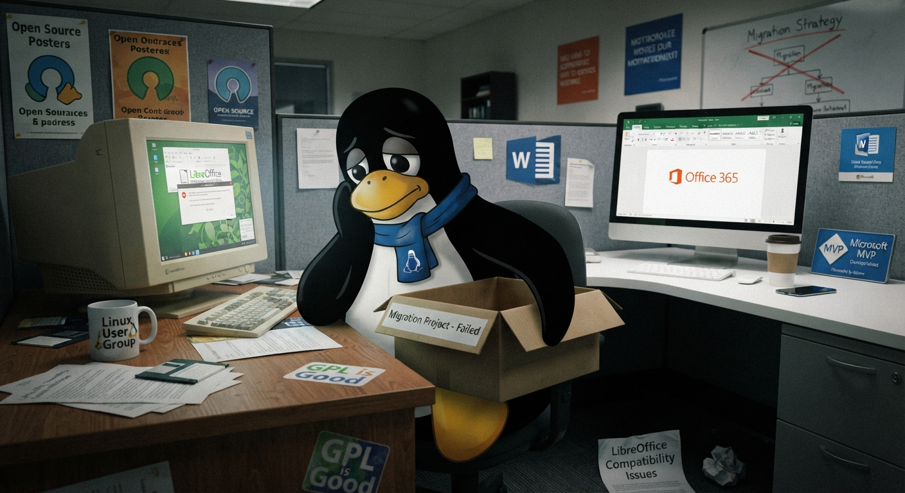

title: The user experience lock-in is a concrete limit.
date: 2026-11-05 19:30
mastodon: https://floss.social/@gisgeek/117565289138335732
tags: foss, desktop, personal computing, technology, society
summary: The rough truth about UX lock-in in complex software
---

Again, a relatively new MS Office replacement project failed in Denmark [1].
It’s not the first, and it will not be the last. In this case, the tentative
replacement was Collabora, a variant of LibreOffice with some cloud-oriented
improvements and even some shortcomings (e.g., missing database support).  As
noted, this is not new; past projects failed in exactly the same way, across
Europe, for years [2-4].

The main reasons are a combination of the immaturity of some (well, a good
number of them) key features (including full format compatibility for documents)
and users' strong dependence on a specific UX. I mean, it is especially hard for
users to change habits in workflows built over years, even when motivated by
costs. Target FOSS projects have never tried to replicate their proprietary
counterparts fully, and the result has always been a failure to replace
proprietary software. We've seen the same scene for years. LibreOffice against
Microsoft Office, Gimp against Photoshop, FreeCAD against AutoCAD, and many
others wannabe functional replacements. Either the features or the interfaces
are not comparable, and users have legitimate concerns about the future of such
alternatives, especially when they are basing their own business on them.

A recent variant is the new set of vibecoded programs (the Artcraft series [5])
that try to replicate the same user interfaces as Adobe tools and, again,
Microsoft Office. Of course, that goal is wishful thinking, and replicating all
aspects (and idiosyncrasies) of a complex user interface isn't something you can
do in a few weeks, even with dozens of AI agents working at the same time.
Indeed, the whole suite is still in the alpha stage, and in practice, expert
users find bugs and inconsistencies at large. We will see how the whole
experiment goes in the future, but for now, it's a hype moment, with very little
hope of widespread adoption. Fees are not the only problem for users; they make
investments in terms of knowledge and time, and switching complex applications
is not like switching socks.

That is why any such big switching projects with a broad user base are doomed. I
know at least half a dozen MS Office alternatives, both FOSS and proprietary,
but I never saw broad adoption for any of them. They are perfectly usable in
many contexts, but the hidden cost of switching is often too high for the
average user. This is the usual combination of the rule of the first mover and
the network effect, the same reasons why most users are WhatsApp addicted
instead of becoming Telegram or Signal users.

The truth is that these kinds of moves require deep user conviction to manage
technical difficulties and learn a totally new daily workflow, and that’s more
impactful when the software is complex enough to require weeks or months of
effort. This isn't something that can be decided at the top level based only on
costs or government policy, because users need a learning path, and that implies
investments in time and money. Other countries are trying to follow the same
path of ditching MS Office and other proprietary applications or OS; we will see
the results in the long term, but I’m quite pessimistic about the possible
outcomes.

_Once you start down the dark path, forever will it dominate your destiny_. (Yoda)

## References

[1][Denmark abandoned plans to ditch MS Office](https://www.neowin.net/news/denmark-has-abandoned-plans-to-ditch-microsoft-office-after-technical-problems/) 

[2][Friburg dumping OpenOffice for Microsoft](https://www.theregister.com/software/2012/11/20/german-city-dumping-openoffice-for-microsoft/719037)

[3][The LiMux project in Munich](https://en.wikipedia.org/wiki/LiMux)

[4][Another German state plans switch back from Linux to Windows](https://www.theregister.com/software/2018/07/27/another-german-state-plans-switch-back-from-linux-to-windows/1541243)

[5][ArtCraft toolset against Adobe monopoly](https://www.domusweb.it/en/news/2026/10/14/artcraft-ai-adobe-open-source-software-monopoly.html)

