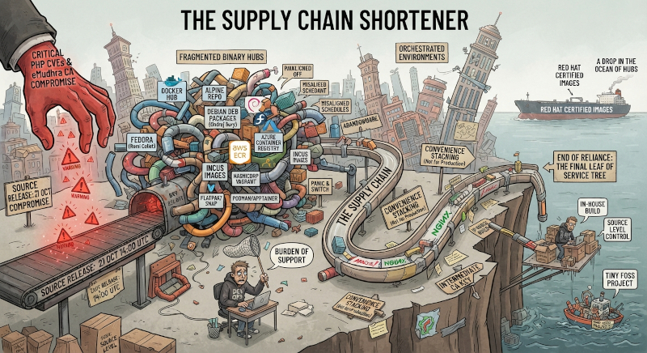

title: Why binary hubs are a non-go choice
date: 2026-11-12 18:30
tags: development, programming, security, technology, enterprise
summary: The binary hubs are a a mine field for security management.
---

The latest critical [PHP security flaw ](https://en.wikipedia.org/wiki/PHP2Shell) 
clearly demonstrates one of the aspects
too often neglected in the modern containerized world by naive DevOps. The
supply chain needs to be as short as possible, and this is a necessary condition
that directly affects any application deployment. Let me explain why. 

As you possibly know, the PHP team coordinated a series of source releases on 21
October at 14:00 UTC for the supported (non-EOL) versions of the PHP language
(i.e., from 8.2+), in order to fix two reported critical CVEs. 

Debian thanks Ondrej Sury and others for LTS versions in Debian 9+ fixed
versions from PHP v5.6 up to 8.4 in a few hours after the PHP release. More than
500 binaries for multiple architectures, versions, and distributions. The same
for Remi Collet about RPM packages in Fedora, presumably.

Nowadays, it happens that most of the deployments of services worldwide are done
in containerized and orchestrated environments, where images are distributed on
independent hubs. Many different ones, a highly fragmented scenario. Even if
images are built from Debian distributions, as well as Alpine, AWS, Azure, or
tons of others, they still need to be updated. All of them, and often. And I
mean very often. That is true for Docker Hub, as for any other containerization
system (e.g., Incus, HashiCorp, Flatpak, Snap, Podman, Apptainer/Singularity,
etc.). Unfortunately, many images out there are built by secondary teams with
misaligned upgrade schedules, so the safest approach is to build images
independently from well-known distributions with clear security support, or
directly from upstream sources, with all required patches for the running
environment. Such a workflow can only be mitigated when services are not
directly exposed to the public network, and proper filters are applied.

In practice, the time and effort you save with containerization and third-party
hubs should be spent again building in-house images and setting up a complete
CI/CD workflow (maybe not continuous, but on demand and with different levels of
depth in building environments), starting from sources and the usual common
distributions, whenever possible.  In a previous post, I already wrote about
that: the burden of support has now shifted to users and each development team;
most of the tiny FOSS projects are simply succumbing to that. What only
distribution security teams once did is now delegated to the final leaf of the
service tree. That is all of us. Around the same time as the PHP drama, the
[eMudhra intermediate CA keys were also compromised](https://en.wikipedia.org/wiki/EMudhra#2026_weak_key_incident): 
another basic piece of information to update in tons of images. This is
what is now universally known as
[the Black October](https://en.wikipedia.org/wiki/Black_October_(information_security)).

Even in many cases in small companies, academia, and small teams, some services
are, in practice, abandonware for what concerns the basic system: they work
until they work, because the application is fine for the goals, but the whole
software support stack is practically frozen as is, because such services run
for years and are untouched for longer. I have concretely seen such problems in
research environments where, in many cases, there are no CI/CD flows ready for
managing events like the PHP flaw in almost real time. In the PHP case, the
result was widespread panic, and many services were switched off or forcibly
closed even days after the event. All that after a series of CVE reports about
Apache, Nginx, and the intermediate CA compromise: a sign of a general problem
with security monitoring. Same scenario, different programs.

All this heavily impacts application chains and directly influences
architectural choices. It is not time to stack together software layers on the
basis of present convenience and the taste of a particular development team.
While that can still be considered for experimental stuff (directed to trash,
not production) and playing with interesting proposals, building up solutions of
any kind, even at a personal or small scale, piling up images because they are
available at a binary download distance from whatever hub is not something
viable nowadays. 

A few days ago, I saw a presentation about Red Hat solutions for certified
images, including CVE reports solved and pending for their distributed images: a
drop in the ocean of hubs out there, unfortunately. That explains why, in my
opinion, nowadays, the chain of third-party dependencies needs to be as short as
possible. It is no longer time to depend on external binary hubs, and the whole
software stack must be fully controlled at the source level in order to ensure
in-house immediate updates. That is, if you care about your security at the
system level for more than a few weeks of lifetime.

At the same time, the whole chain of source dependencies needs to be as short
and safe as possible to avoid nightmares such as the not-so-funny dependency on
the work of an obscure Nebraska guy, as in the 
[XKCD well-known vignette](https://xkcd.com/2347/). 
For instance, introducing tons of avoidable dependencies on trivial external
modules, as we've seen in the Node.js ecosystem, is a sure way to get future
problems, including security ones. But I wrote about minimalism in [a previous
post](/a-call-to-minimalistic-programming.html), and I redirect you to that on
this topic.
