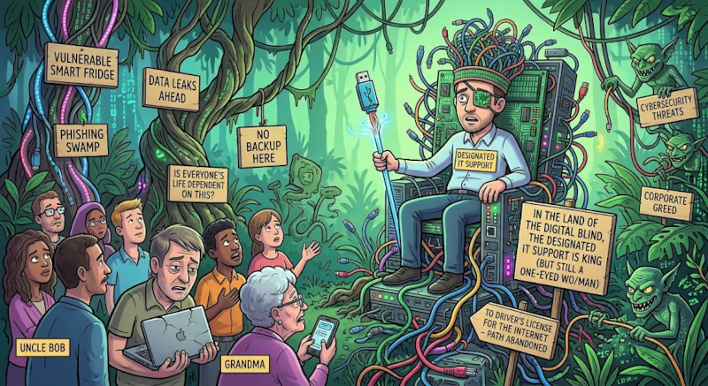

title: IT security is also a problem of uncle Bob
date: 2026-11-16 19:00
tags: rant, security, society, technology, digital rights
mastodon: https://floss.social/@gisgeek/117627592058752351
summary: The security problem is also a problem of uncle Bob and your grandma
---

A few days ago, on Mozilla’s blog, a brief article entitled  
[An open letter to every family’s designated IT support](https://blog.mozilla.org/en/firefox/set-firefox-default-mobile-browser/) 
was posted. What appeared as a joke is indeed the reality of any micro-community around the globe, from families to
small offices and any small-scale groups of individuals glued together. The
designated IT support is the most widespread form of IT support. Yes, usually
(s)he is the most competent among members of such informal groups, though not
competent in absolute terms. Often, a one-eyed (wo)man in the land of the blind
is king, says a proverb here.

Often, a single person (no backup intended) in such small worlds becomes the
group's IT center of competence, with predictable consequences when efforts need
to scale up. 

While this is annoying (for the designated IT support victim/person) but
manageable at the family level, this is a problem today at the mid-range level,
because IT services and the number of non-personal devices connected to the
Internet haven't scaled with that one person.  Who could have imagined a few
years ago that even a small business shop network would need professional IT
support to [manage fridges properly](https://www.bbc.com/news/articles/cq1kd1nee80eo)
and avoid remote exploitation, as happened recently worldwide? 

I know these realities perfectly well: an external support team installs a
certain number of smart devices with remote control, delegates updates
informally to Mr. Nobody, and does not even apply minimal security measures
(such as password diversification and rotation, or firewall filters, to name the
most obvious). What is clearly missing is any minimal security information and
training for the workers whose jobs are completely different and are not
interested at all in proper infrastructure maintenance. The disaster is ensured
later on.

A few days ago, 3700 schools in Italy received [the same bomb alert](https://www.reuters.com/world/least-300-italian-schools-evacuated-after-email-bomb-alerts-2026-11-11/) via a scam email from the Philippines by an improbable Mr. Andropov: more than 70 of them
evacuated, some not just because the anti-spam filter worked. Schools, at the
same time, often have no technical staff and no IT support at all, but for some
_designated_ IT expert, chosen among _guys who understand about computers_.

The point is: is it nowadays conceivable that the security of digital processes
is delegated to Mr. Nobody? Or that the average worker is launched into digital
workflows without basic periodic security training? When and how will schools,
shops, and micro/small companies understand that digital processes are now
structural parts of the core business of any production reality, not a necessary
evil to tolerate and barely understand?

In our lives, networks, services, and digital processes are fully part of life,
but for some reason, most people still treat them as a big mystery, as if their
own lives didn't depend on them. That’s also why data are seen as low-value
assets and given away for free to any social media company, with very low
barriers to accepting conditions . The data leaks that happen from time to time
for personal data are the icing on the cake, often stolen to  be used to apply
social engineering techniques at the expense of unsuspecting users all around
the world. Many people lack basic training in digital self-defense, like
children abandoned in a tropical forest.

Is it too much to expect that, instead of waiting for so-called designated IT
support, each person learns the basics of security and digital awareness to
defend themselves in today's information jungle, for cybersecurity threats as
well as companies' greed and abuse? The first defense line is your old uncle and
grandmother, like them or not. We introduced driver's licenses at the end of the
19th century, but we still struggle to admit that the modern digital world
requires the same level of awareness and skills to avoid accidents. As for
vaccinations, security infections target the weakest link; prevention also
requires training for all users in this digital world, so they're prepared to
live in it and protect the weakest members of the community.
